# Enterprise Network & Windows Server Infrastructure Lab

This repository documents a hands-on IT infrastructure lab built for portfolio practice. It combines a Cisco Packet Tracer network design with a VMware-based Windows Server environment to demonstrate common System, Network, and IT Support administration tasks.

Cisco Packet Tracer and VMware are complementary lab environments in this project. Packet Tracer represents the network layer, while VMware represents the Windows server and client services layer. They are not directly connected in this implementation.

## Objectives

- Design a segmented enterprise network using VLANs.
- Configure 802.1Q trunking, inter-VLAN routing, ACL-based Guest isolation, and NAT/PAT.
- Deploy Windows Server 2022 as `SERVER01`.
- Configure Active Directory Domain Services for the `corp.local` domain.
- Implement DNS, DHCP, Group Policy, SMB file sharing, and NTFS permissions.
- Join `CLIENT01` to the domain and validate user login, DNS, DHCP, GPO, and mapped drives.
- Document the lab clearly for an intern System / Network / IT Support portfolio.

## Architecture Overview

The lab is organized into two layers:

| Layer | Environment | Purpose |
|---|---|---|
| Network infrastructure | Cisco Packet Tracer | VLANs, trunks, routing, ACLs, NAT/PAT, and simulated public connectivity |
| Windows infrastructure | VMware Workstation | Active Directory, DNS, DHCP, Group Policy, File Server, and Windows client validation |

Packet Tracer file: [packet-tracer/Enterprise_Network_Lab.pkt](packet-tracer/Enterprise_Network_Lab.pkt)

## Technologies Used

| Area | Technologies |
|---|---|
| Network simulation | Cisco Packet Tracer |
| Virtualization | VMware Workstation |
| Server operating system | Windows Server 2022 |
| Client operating system | Windows 10 Pro |
| Directory and identity | Active Directory Domain Services |
| Network services | DNS, DHCP |
| Policy management | Group Policy |
| File services | SMB File Sharing, NTFS Permissions |
| Network concepts | VLANs, 802.1Q trunking, Inter-VLAN routing, ACLs, NAT/PAT |

## Network Infrastructure

The network portion was built in Cisco Packet Tracer. It simulates a small enterprise network with an edge router, core and access switches, multiple VLANs, a Management VLAN, Guest isolation, and NAT/PAT for simulated public connectivity.

Full device configurations are stored separately:

| Device | Configuration file |
|---|---|
| `R1-EDGE` | [configs/r1-edge-config.txt](configs/r1-edge-config.txt) |
| `SW-CORE` | [configs/sw-core-config.txt](configs/sw-core-config.txt) |
| `SW-USERS` | [configs/sw-users-config.txt](configs/sw-users-config.txt) |
| `SW-SERVER` | [configs/sw-server-config.txt](configs/sw-server-config.txt) |

### Topology

The topology uses `R1-EDGE` as the router for inter-VLAN routing and edge connectivity. `SW-CORE` connects to the access switches for user and server VLANs.

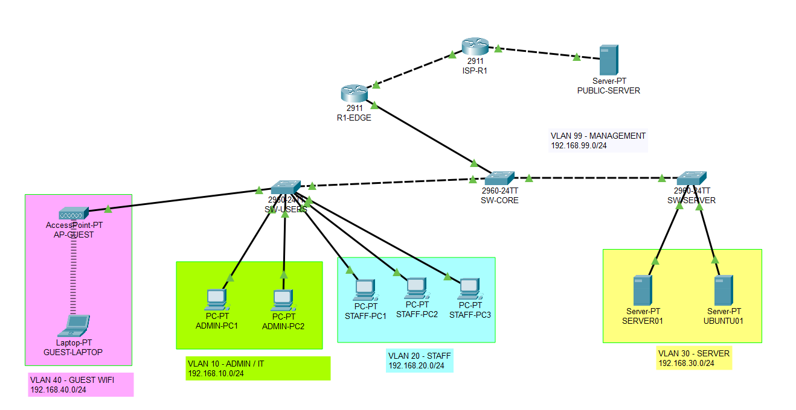

### VLAN Design

Each VLAN separates a specific type of traffic. The router subinterfaces on `R1-EDGE` provide the default gateways for the VLANs.

| VLAN | Name / Purpose | Subnet | Gateway |
|---:|---|---|---|
| 10 | Admin / IT | `192.168.10.0/24` | `192.168.10.1` |
| 20 | Staff | `192.168.20.0/24` | `192.168.20.1` |
| 30 | Server | `192.168.30.0/24` | `192.168.30.1` |
| 40 | Guest WiFi | `192.168.40.0/24` | `192.168.40.1` |
| 99 | Management | `192.168.99.0/24` | `192.168.99.1` |

### Trunking

802.1Q trunk links carry VLAN traffic between `R1-EDGE`, `SW-CORE`, `SW-USERS`, and `SW-SERVER`.

| Link / Device role | Allowed VLANs |
|---|---|
| Router to core switch | `10,20,30,40,99` |
| Core to user switch | `10,20,40,99` |
| Core to server switch | `30,99` |

The validation screenshot shows VLAN and trunk configuration from the switching layer.

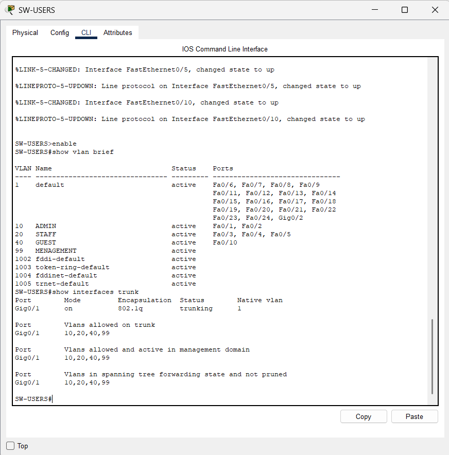

### Inter-VLAN Routing

`R1-EDGE` performs router-on-a-stick inter-VLAN routing using subinterfaces on `GigabitEthernet0/0`.

| Subinterface | VLAN | IP address |
|---|---:|---|
| `G0/0.10` | 10 | `192.168.10.1/24` |
| `G0/0.20` | 20 | `192.168.20.1/24` |
| `G0/0.30` | 30 | `192.168.30.1/24` |
| `G0/0.40` | 40 | `192.168.40.1/24` |
| `G0/0.99` | 99 | `192.168.99.1/24` |

The validation screenshot shows successful routing checks between internal VLANs.

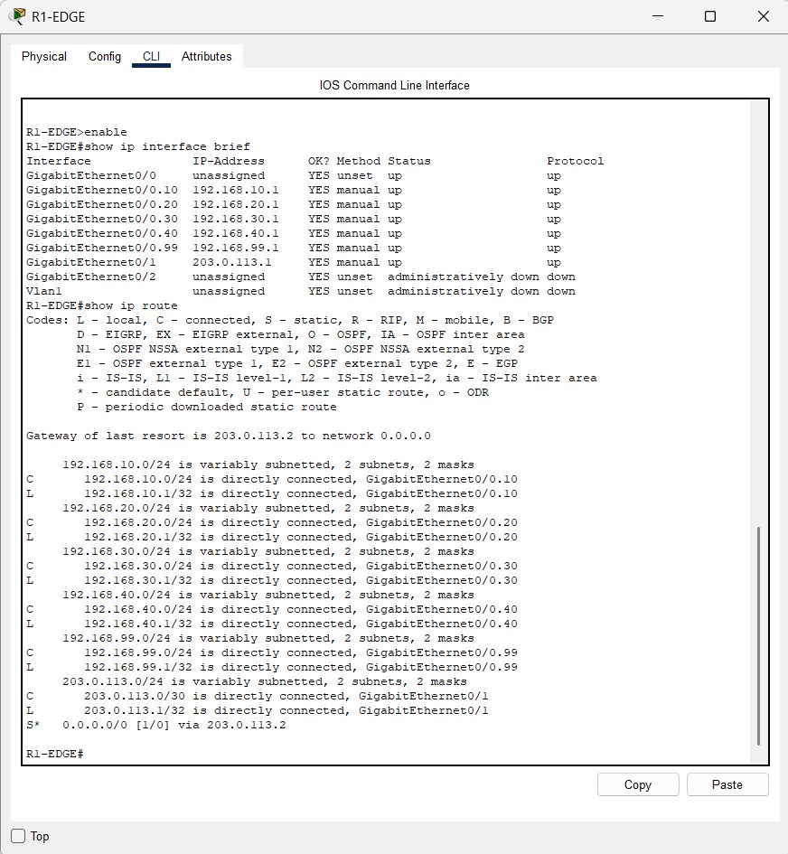

### ACL / Guest Isolation

Guest WiFi traffic in VLAN 40 is restricted from reaching internal VLANs. The `GUEST-ISOLATION` ACL is applied inbound on `G0/0.40`.

| Source | Restricted destination |
|---|---|
| `192.168.40.0/24` | `192.168.10.0/24` |
| `192.168.40.0/24` | `192.168.20.0/24` |
| `192.168.40.0/24` | `192.168.30.0/24` |
| `192.168.40.0/24` | `192.168.99.0/24` |

Guest traffic is still permitted to reach non-internal destinations for the simulated external network.

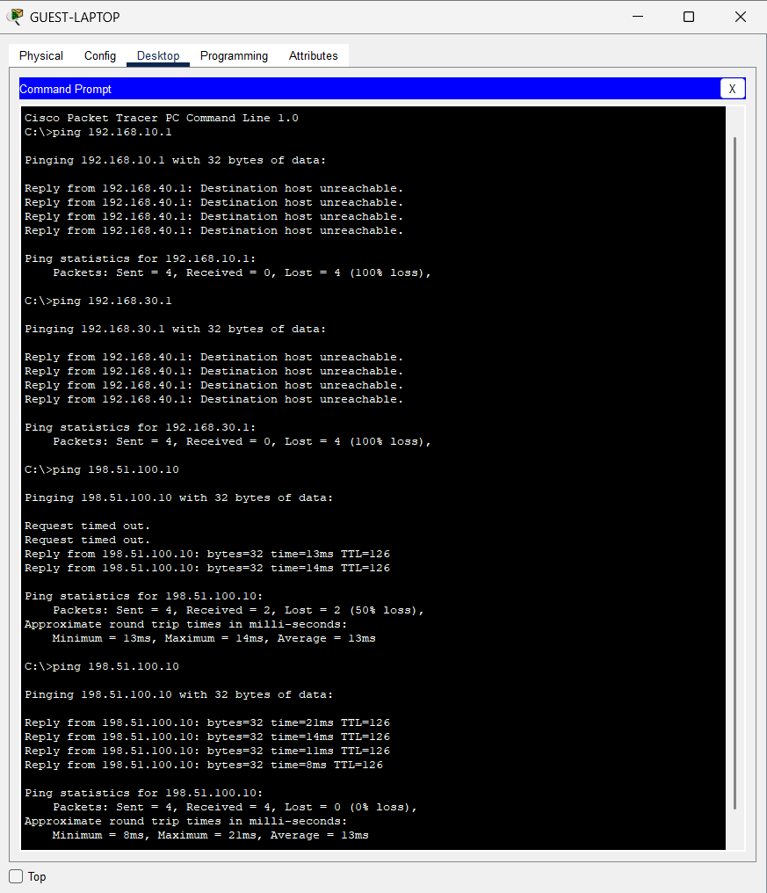

### NAT/PAT

`R1-EDGE` uses NAT/PAT overload for simulated public connectivity. Internal VLAN traffic is translated through the outside interface on `GigabitEthernet0/1`.

| Function | Detail |
|---|---|
| Inside networks | VLANs 10, 20, 30, and 40 |
| Outside interface | `GigabitEthernet0/1` |
| Outside IP | `203.0.113.1/30` |
| Default route | `203.0.113.2` |

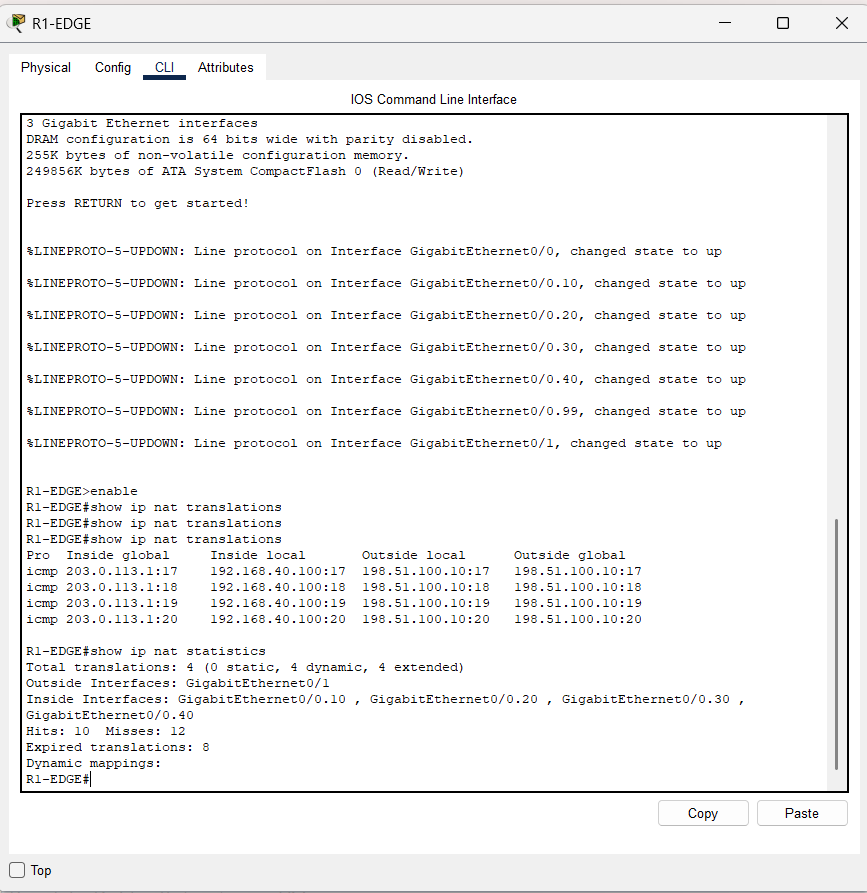

## Windows Server Infrastructure

The Windows infrastructure was deployed in VMware Workstation. `SERVER01` provides domain, DNS, DHCP, Group Policy, and file services for the lab. `CLIENT01` is a Windows 10 Pro domain client used for validation.

### SERVER01

| Item | Value |
|---|---|
| Server name | `SERVER01` |
| Operating system | Windows Server 2022 |
| IP address | `192.168.30.10/24` |
| DNS server | `192.168.30.10` |
| Domain | `corp.local` |
| Client computer | `CLIENT01` |
| Client OS | Windows 10 Pro |

### Active Directory

Active Directory Domain Services was installed on `SERVER01` for the `corp.local` domain. A main `CORP` OU was created to organize computers, groups, servers, and users.

### OU Structure

```text
corp.local
+-- CORP
    +-- Computers
    +-- Groups
    +-- Servers
    +-- Users
        +-- IT
        +-- HR
        +-- Accounting
        +-- Sales
```

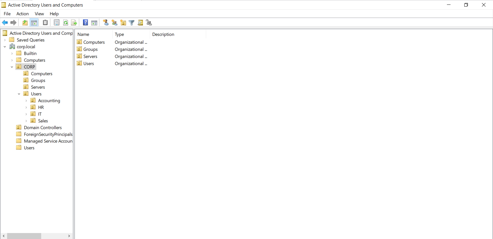

### Security Groups

Department security groups were created to control file access and drive mappings.

| Department | Security group | Sample user |
|---|---|---|
| IT | `GG_IT` | `an.nguyen` |
| HR | `GG_HR` | `lan.tran` |
| Accounting | `GG_Accounting` | `hoa.le` |
| Sales | `GG_Sales` | `nam.pham` |

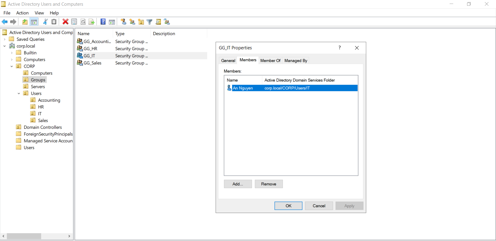

### DNS

`SERVER01` provides DNS for the `corp.local` domain. Forward and reverse lookup were configured, including reverse DNS for the `192.168.30.0/24` network.

| DNS item | Value |
|---|---|
| DNS server | `192.168.30.10` |
| Forward lookup zone | `corp.local` |
| Reverse lookup network | `192.168.30.0/24` |
| Server record | `SERVER01.corp.local` |

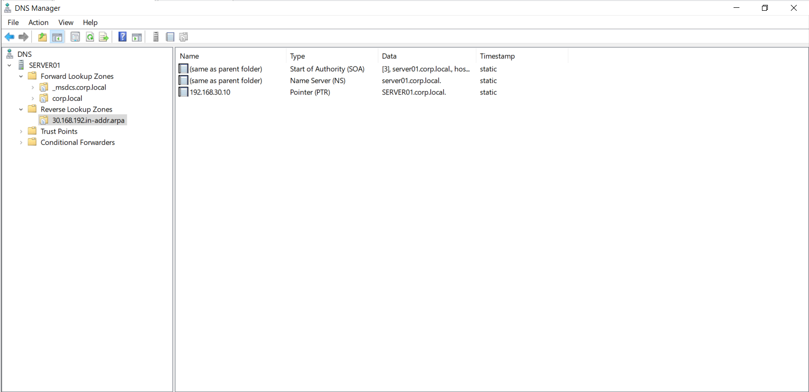

### DHCP

DHCP was configured on `SERVER01`. `CLIENT01` was reserved to receive `192.168.30.20`.

| DHCP setting | Value |
|---|---|
| DHCP server | `SERVER01` |
| Scope range | `192.168.30.20` to `192.168.30.100` |
| Client reservation | `CLIENT01` -> `192.168.30.20` |
| DNS option | `192.168.30.10` |
| Domain option | `corp.local` |

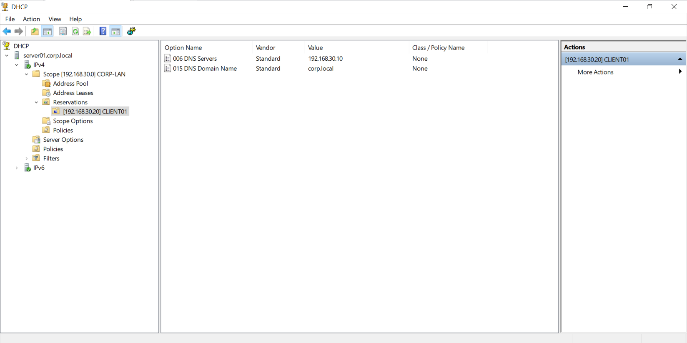

`CLIENT01` was changed from static addressing to DHCP and received its IP and DNS configuration from `SERVER01`.

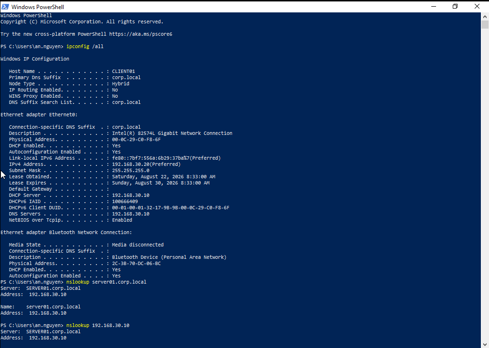

### Group Policy

Two Group Policy Objects were created and linked to the correct OUs.

| GPO | Linked location | Purpose |
|---|---|---|
| `GPO-CLIENT-BASELINE` | `CORP\Computers` | Computer baseline settings |
| `GPO-USER-BASELINE` | `CORP\Users` | User restrictions and drive maps |

User restrictions tested in the lab include Control Panel, Command Prompt, and Registry Editor restrictions.

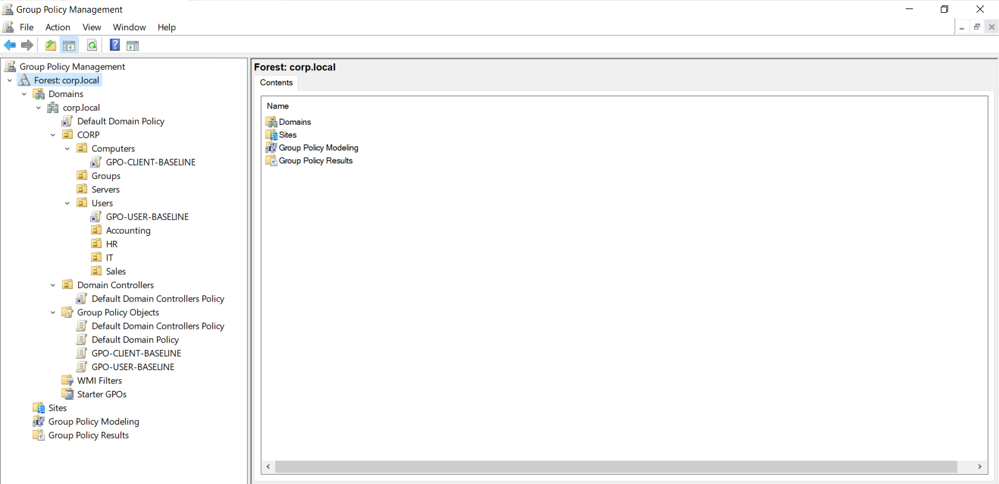

The restriction validation screenshot shows the user policy applying on `CLIENT01`.

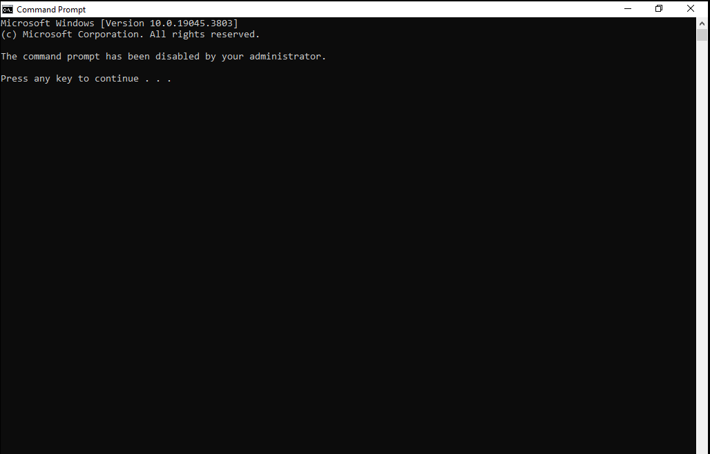

### File Server

The file server data folder was created on `SERVER01` and shared using SMB.

| Item | Value |
|---|---|
| Local path | `D:\CORP-DATA` |
| SMB share | `\\SERVER01\CORP-DATA` |
| Folders | `IT`, `HR`, `Accounting`, `Sales`, `Public` |

Department groups receive Modify permission to their own department folder.

| Folder | Group with Modify permission |
|---|---|
| `IT` | `GG_IT` |
| `HR` | `GG_HR` |
| `Accounting` | `GG_Accounting` |
| `Sales` | `GG_Sales` |

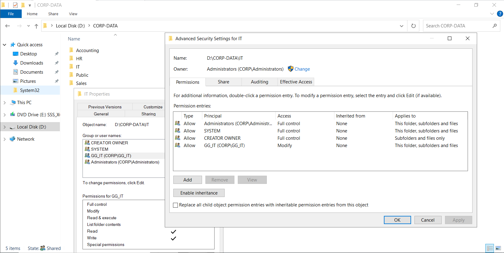

### Mapped Drives

Group Policy Preferences and item-level targeting were used to map department drives based on security group membership.

| Security group / users | Drive | Network path |
|---|---|---|
| `GG_IT` | `I:` | `\\SERVER01\CORP-DATA\IT` |
| `GG_HR` | `H:` | `\\SERVER01\CORP-DATA\HR` |
| `GG_Accounting` | `A:` | `\\SERVER01\CORP-DATA\Accounting` |
| `GG_Sales` | `S:` | `\\SERVER01\CORP-DATA\Sales` |
| Public | `P:` | `\\SERVER01\CORP-DATA\Public` |

For the validated IT user `CORP\an.nguyen`, the expected mapped drives are `I:` and `P:`.

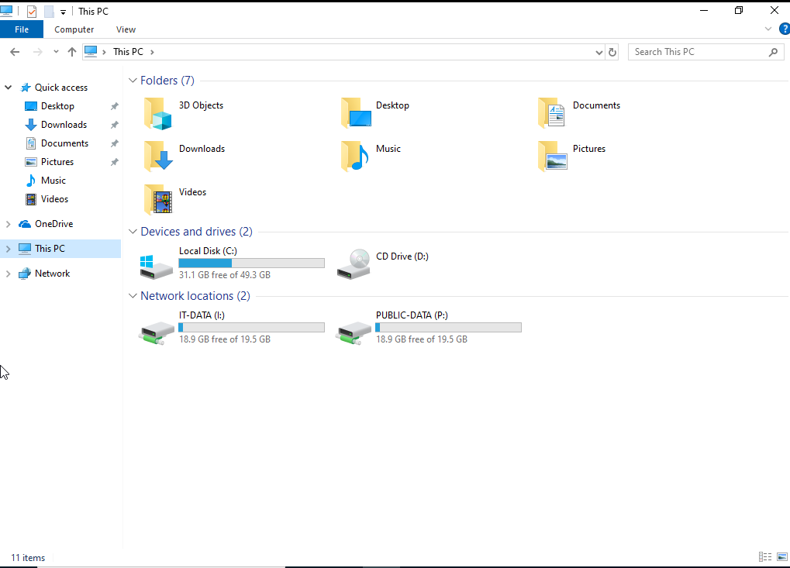

### Client Validation

`CLIENT01` was joined to the `corp.local` domain and tested with the domain user `CORP\an.nguyen`.

| Validation item | Result |
|---|---|
| Domain user | `CORP\an.nguyen` |
| Hostname | `CLIENT01` |
| Logon server | `\\SERVER01` |
| DHCP address | `192.168.30.20` |
| DNS server | `192.168.30.10` |

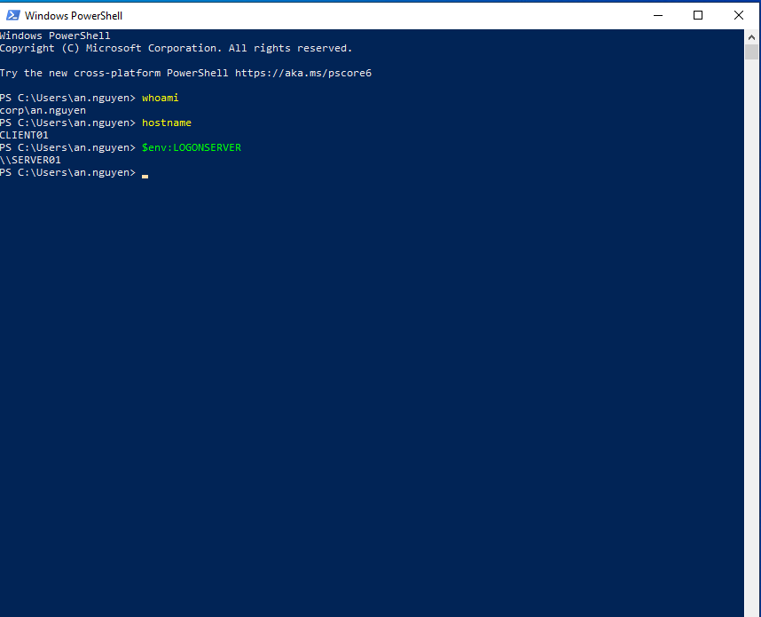

The final policy validation confirms that Group Policy was applied to the client.

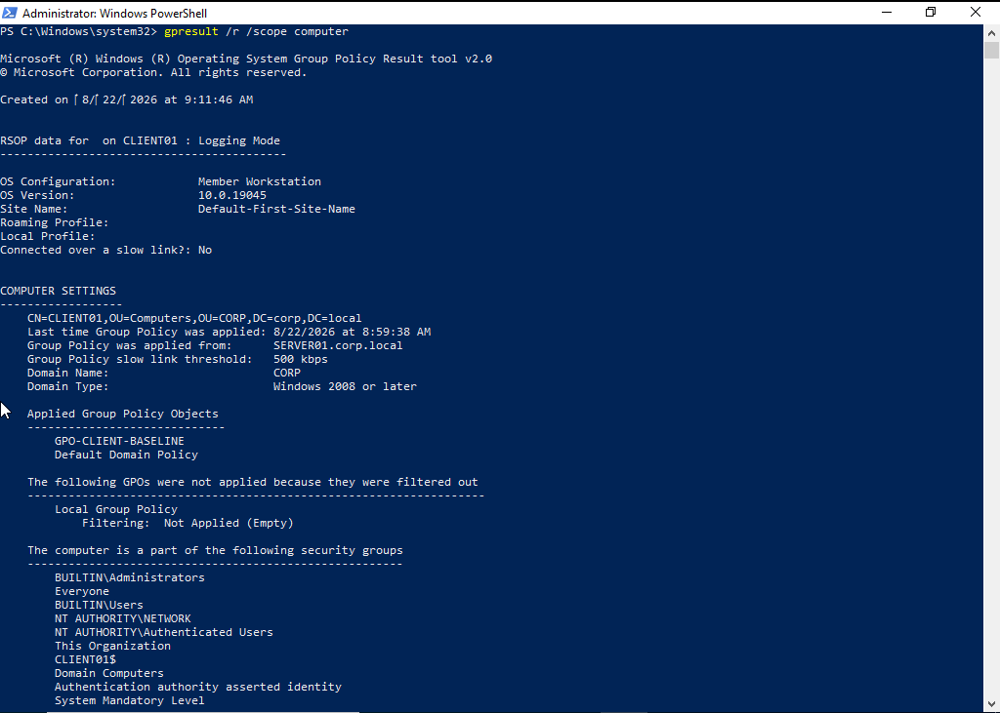

## Testing and Validation

| Test | Evidence / command used | Result |
|---|---|---|
| VLAN and trunk configuration | Packet Tracer switch validation | Pass |
| Inter-VLAN routing | Routing validation screenshot | Pass |
| Guest isolation ACL | Guest ACL validation screenshot | Pass |
| NAT/PAT | NAT/PAT validation on `R1-EDGE` | Pass |
| Domain login | `whoami` as `corp\an.nguyen` | Pass |
| Hostname validation | `hostname` -> `CLIENT01` | Pass |
| Logon server validation | `%logonserver%` -> `\\SERVER01` | Pass |
| DNS forward lookup | `SERVER01.corp.local` lookup | Pass |
| DNS reverse lookup | `192.168.30.10` PTR lookup | Pass |
| DHCP lease | Client received DHCP from `SERVER01` | Pass |
| DHCP reservation | `CLIENT01` received `192.168.30.20` | Pass |
| GPO application | `gpresult` / policy validation | Pass |
| CMD restriction | User restriction validation | Pass |
| IT folder access | `CORP\an.nguyen` access to IT folder | Pass |
| Cross-department restriction | Department access restriction test | Pass |
| IT mapped drive | `I:` mapped for `GG_IT` | Pass |
| Public mapped drive | `P:` mapped for Public | Pass |

## Troubleshooting Lessons

Troubleshooting notes are documented in [docs/troubleshooting.md](docs/troubleshooting.md).

| Issue | Cause | Resolution |
|---|---|---|
| `gpresult /r /scope computer` returned Access Denied | Command was run from a non-elevated shell | Opened PowerShell as Administrator and reran the command |
| `CLIENT01` still showed DHCP disabled | Client adapter was still using static IP settings | Enabled DHCP, reset DNS settings, and renewed the lease |
| `nslookup` showed DNS server as Unknown | Reverse lookup / PTR record was missing | Created the reverse lookup zone and PTR record for `SERVER01` |

## Repository Structure

```text
Enterprise Network & Windows Server Infrastructure Lab/
+-- README.md
+-- configs/
|   +-- r1-edge-config.txt
|   +-- sw-core-config.txt
|   +-- sw-server-config.txt
|   +-- sw-users-config.txt
+-- docs/
|   +-- project-notes.md
|   +-- troubleshooting.md
+-- images/
|   +-- 01-network-topology.png
|   +-- 02-vlan-trunk-validation.png
|   +-- 03-routing-validation.png
|   +-- 04-guest-acl-validation.png
|   +-- 05-nat-pat-on-r1-edge.png
|   +-- 06-active-directory-ou-structure.png
|   +-- 07-security-group-membership.png
|   +-- 08-dhcp-reservation-options.png
|   +-- 09-dns-forward-reverse.png
|   +-- 10-client-dhcp-dns-validation.png
|   +-- 11-group-policy-management.png
|   +-- 12-gpo-restriction-validation.png
|   +-- 13-file-server-ntfs-permission.png
|   +-- 14-client-drive-mapping.png
|   +-- 15-client-domain-validation.png
|   +-- 16-gpo-applied-validation.png
+-- packet-tracer/
    +-- Enterprise_Network_Lab.pkt
```

## Key Learning Outcomes

- Practiced VLAN segmentation, trunking, inter-VLAN routing, ACLs, and NAT/PAT in Cisco Packet Tracer.
- Built a Windows Server 2022 domain environment in VMware Workstation.
- Organized Active Directory with OUs, department users, and security groups.
- Configured DNS forward and reverse lookup for the domain.
- Configured DHCP scope options and a reservation for a Windows client.
- Applied user and computer settings through Group Policy.
- Implemented SMB file sharing with group-based NTFS permissions.
- Used Group Policy Preferences and item-level targeting for mapped drives.
- Validated a Windows 10 Pro domain client using common IT support commands and checks.
